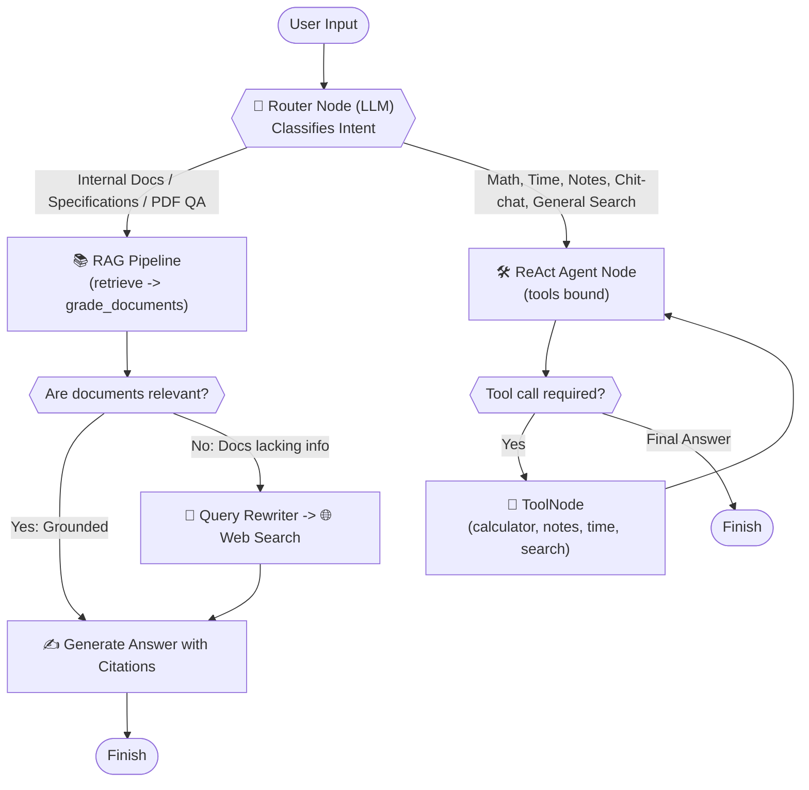

# ⚡ NVIDIA Nemotron 3 Ultra - Langgraph RAG Agent

A production-ready conversational AI agent built with **LangChain**, **LangGraph**, and **NVIDIA Nemotron 3 Ultra** (`nvidia/nemotron-3-ultra-550b-a55b`).

Nemotron 3 Ultra is NVIDIA's flagship 550B-parameter Mixture-of-Experts (MoE) reasoning model engineered specifically for autonomous agent orchestration, complex multi-step reasoning, and precision tool calling.

---

## 🌟 Features

- **NVIDIA NIM Integration**: Native integration with NVIDIA Foundation Models via `ChatNVIDIA` (or OpenAI-compatible NIM endpoint).
- **Tool-Augmented Reasoning**:
  - 🌐 **Live Web Search** (`DuckDuckGo`) for current events and documentation.
  - 🧮 **Safe Calculator** for complex mathematical computations.
  - 🕒 **DateTime & Timezone** queries.
- **Persistent Memory**: Stateful multi-turn conversation memory with thread-level persistence via LangGraph `MemorySaver`.
- **Agentic / Corrective RAG (CRAG)**: Multi-node LangGraph workflow featuring document retrieval from ChromaDB, LLM relevance grading, automated query rewriting, and web search fallback.
- **Dual Interfaces**:
  - 💻 **Interactive CLI**: Colored terminal chat with real-time tool & graph execution logs (`/mode`, `/ingest`).
  - 🌐 **Modern Web UI**: Streamlit web chat with document drag-and-drop ingestion, collection metrics, and node execution tracing.

---

## 📁 Project Structure

```text
LangchainAgent/
├── data/
│   ├── docs/          # PDF, TXT, and MD documents to index
│   └── chroma_db/     # Persistent local Chroma vector database
├── rag/
│   ├── __init__.py
│   ├── state.py       # GraphState schema for LangGraph
│   ├── embeddings.py  # FastEmbed ONNX local embeddings + NIM fallback
│   └── ingest.py      # Document loader, chunker, & vector store indexing
├── config.py          # Configuration and environment validation
├── tools.py           # Agent tools (Web search, Calculator, DateTime, Notes)
├── graph.py           # LangGraph Adaptive Router Graph (RAG + ReAct)
├── agent.py           # LangGraph agents & LLM initialization
├── main.py            # Terminal / CLI interactive chat application
├── app.py             # Streamlit web chat interface
├── requirements.txt   # Python package dependencies
├── .env.example       # Example configuration file
└── README.md          # Project documentation
```

---

## 🧠 Autonomous Architecture & Workflow

### 1. How the Autonomous Architecture Works



#### Architecture Description

The agent operates on an **Autonomous Intent-Routed StateGraph** built with LangGraph:

1. **Router Node (`router`)**:
   - Acts as the intelligent traffic controller.
   - Evaluates incoming queries using the LLM to classify user intent without requiring any manual UI toggles.
   - Dynamically routes queries to either the **RAG Pipeline** or the **ReAct Tool-Calling Agent**.

2. **RAG Pipeline (Document Question Answering & Verification)**:
   - **`retrieve`**: Uses local fast ONNX vector embeddings (`BAAI/bge-small-en-v1.5` via FastEmbed) to query the persistent ChromaDB collection.
   - **`grade_documents`**: The LLM evaluates retrieved chunks for relevance (`yes` / `no`), filtering out noise.
   - **Adaptive Fallback (`transform_query` & `web_search`)**: If the indexed documents do not contain the answer, the agent autonomously rewrites the query and pulls live context from DuckDuckGo.
   - **`generate`**: Synthesizes a factual response strictly grounded in verified context, complete with source citations (e.g. `[source.pdf, Page 1]`).

3. **ReAct Branch (Tool Execution & General Reasoning)**:
   - **`react_agent`**: Binds tools to the model with systematic multi-step reasoning.
   - **`tools`**: Executes tools such as:
     - 🧮 **Safe Calculator**: Evaluates complex mathematical expressions.
     - 🕒 **DateTime**: Resolves local/UTC timestamps.
     - 📝 **Notes**: Records and lists personal memos (`create_note`, `list_notes`).
     - 🌐 **Web Search**: Queries real-time facts and documentation.
   - Loops between tool execution and reasoning until a complete answer is formed.


---

## 🚀 Quickstart Guide

### 1. Prerequisites
- Python 3.10+ (Tested on Python 3.11)
- An NVIDIA API Key.

### 2. Get an NVIDIA NIM API Key
1. Visit the [NVIDIA API Catalog](https://build.nvidia.com/).
2. Select any model (e.g., [Nemotron](https://build.nvidia.com/nvidia/nemotron-3-ultra-550b-a55b)).
3. Click **Get API Key** and generate your key (starts with `nvapi-...`). Free credits are provided.

### 3. Setup Virtual Environment & Install Dependencies
Open your terminal in the project directory:

```bash
# Create virtual environment
python -m venv .venv

# Activate virtual environment
# Windows (PowerShell):
.venv\Scripts\Activate.ps1
# Windows (Command Prompt):
.venv\Scripts\activate.bat
# Linux / macOS:
source .venv/bin/activate

# Install requirements
pip install -r requirements.txt
```

### 4. Configure Environment Variables
Copy `.env.example` to `.env`:

```bash
cp .env.example .env
```

Open `.env` and fill in your API key:
```env
NVIDIA_API_KEY=nvapi-your-key-here
NVIDIA_MODEL=nvidia/nemotron-3-ultra-550b-a55b
```

---

## 💬 Running the Chat Agent

### Option A: Interactive Terminal Interface (CLI)
Run:
```bash
python main.py
```
**In-Chat Commands:**
- `/mode` — Switch between **Agentic RAG** and **General ReAct Agent**.
- `/ingest` — Automatically index all `.pdf`, `.txt`, and `.md` files in `data/docs/`.
- `/help` — Display command guide.
- `/tools` — Show list of available tools.
- `/clear` — Start a fresh conversation thread.
- `/exit` — Quit the application.

### Option B: Web UI (Streamlit)
Run:
```bash
streamlit run app.py
```
This opens an interactive chat UI in your browser (`http://localhost:8501`) where you can:
- Switch between **RAG Document Assistant** and **General ReAct Agent**.
- Drag and drop PDFs and text documents to index them into ChromaDB in real-time.
- View step-by-step reasoning (Retrieved Chunks, LLM Relevance Grading, Query Transformations, Web Search Fallbacks).

---

## 📚 Document Ingestion & RAG

1. Place your PDF, TXT, or MD files inside the [`data/docs/`](file:///d:/VS%20Code%202/LangchainAgent/data/docs/) directory (or upload via Streamlit).
2. Index your documents via terminal:
   ```bash
   python -m rag.ingest
   ```
   Or inside the CLI using the `/ingest` command.
3. The chunks are embedded using local FastEmbed (`BAAI/bge-small-en-v1.5` - fast & free) and persisted into [`data/chroma_db/`](file:///d:/VS%20Code%202/LangchainAgent/data/chroma_db/).

---

## 🛠️ Adding Custom Tools

You can easily register new tools in [`tools.py`](file:///d:/VS%20Code%202/LangchainAgent/tools.py) using LangChain's `@tool` decorator:

```python
from langchain_core.tools import tool

@tool
def get_stock_price(ticker: str) -> str:
    """Fetch the latest stock price for a given ticker symbol."""
    # Your logic here
    return f"{ticker}: $150.00"

# Add it to the agent_tools list:
agent_tools = [get_current_datetime, calculate, search_web, get_stock_price]
```

---

## 🔄 Supported Models

You can change `NVIDIA_MODEL` in `.env` to any model in the NVIDIA NIM catalog:
- `nvidia/nemotron-3-ultra-550b-a55b` *(Default - Nemotron 3 Ultra Flagship MoE)*
- `nvidia/llama-3.1-nemotron-70b-instruct`
- `nvidia/nemotron-4-340b-instruct`
- `nvidia/nemotron-mini-4b-instruct`
